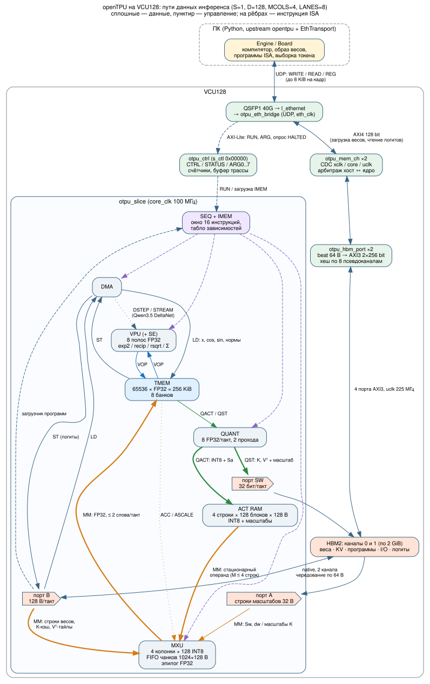

# Как идёт инференс LLM на VCU128 openTPU

Разбор по исходникам upstream (FeSens `f237dab`: `docs/isa.md`, `docs/dataflow.md`,
`docs/compiler.md`, `rtl/top/otpu_slice.sv`, `opentpu/llm/*`) и этого проекта (`src/`,
`tools/otpu_eth.py`). Цифры тактов — из RTL-профилей Lens (`sim/lens/`) и журнала замеров
на плате. Схема путей данных: [diagrams/inference_dataflow.svg](diagrams/inference_dataflow.svg)
(исходник `.dot`, PDF рядом). Пошаговый алгоритм и диаграммы состояний пяти уровней —
[inference_algorithm.md](inference_algorithm.md). Как программы получаются из модели —
[compiler.md](compiler.md).

## 1. Коротко

1. ПК компилирует модель Hugging Face в **образ** и **программы ISA**. Образ — это веса
   INT8/FP4 с масштабами, место под KV-кэш, нормы и таблицы. Программа — это
   последовательность инструкций по 32 байта.
2. Образ один раз записывается в HBM через 40G: UDP → `otpu_eth_bridge` → AXI4 →
   `otpu_mem_ch` → `otpu_hbm_port` → HBM. Для LFM2.5-230M это занимает 8 с.
3. На каждый токен хост пишет несколько регистров: аргументы ARG0..7 (номер токена,
   позиция), затем CTRL=RUN. Слайс исполняет программу целиком: все слои, attention с
   KV-кэшем в HBM, LM head. Логиты записываются в HBM, хост их читает и выбирает
   следующий токен. Есть и режим генерации на плате, где выбор делает сам слайс.
4. Внутри слайса работает **одно правило**: веса и KV-кэш никогда не лежат в «быстрой»
   памяти. Они **стримятся из HBM прямо в MXU** со скоростью 128 B/такт. Активации
   живут в TMEM (FP32), для каждого MM их квантуют в ACT RAM (INT8).
5. Декод упирается в память. Для LFM2.5-230M: 220 МиБ на токен ÷ 12,8 ГБ/с (128 B × 100 МГц)
   ≈ 18 мс. RTL даёт 1,86–1,96 Мтакта, плата — 1,95 Мтакта на токен (51,3 ток/с).

## 2. Путь байтов ПК ↔ HBM (40G)

| Звено | Что делает | Ширина / такт |
|---|---|---|
| `tools/otpu_eth.py` `EthTransport` | вместо upstream `XdmaTransport`, тот же интерфейс `mem_write/mem_read/reg_*/poll`; окно 12 кадров × 8 KiB, повтор по SEQ, C-помощник sendmmsg | UDP 20308, MTU 9000 |
| QSFP1 → `l_ethernet` | 40GBASE-R4, квад 135 | AXIS 256 бит, eth_clk ≈ 322 МГц (журнал) |
| `otpu_eth_bridge` | фильтр, ARP, FIFO кадров 128 KiB, диспетчер WRITE/READ/REG, кэш ответов REG (RUN исполняется ровно один раз) | AXI4 128 бит на канал; AXI-Lite 20 бит |
| `axil_cdc` → `vcu128_axil_xbar` | регистры: 0x00000 `otpu_ctrl`, 0x40000 платформа/HBM, 0x60000 MAC; 0x50000 — `eth40_regs` | — |
| `otpu_mem_ch` ×2 (upstream) | CDC xclk ↔ core ↔ uclk; арбитраж хоста и ядра (RUN=32 команды); 16-байтные биты → 64-байтные beat | native: 1 beat 64 B/команда |
| `otpu_hbm_port` ×2 (проект) | beat → AXI3-пакет 2×256 бит; хеш по 8 псевдоканалам `pc = b[2:0]^b[5:3]`; RAW/WAR/WAW по beat | uclk 225 МГц, 32 B/такт на порт |
| HBM2 | канал `j` = 2 GiB с адреса `j·2 GiB`, псевдоканалы 8j…8j+7 | — |

Логическое адресное пространство слайса чередуется между двумя каналами по 64 B:
beat `b` → канал `b mod 2` (с XOR-хешем CHASH). Чанк MXU в 128 B — это один beat из каждого
канала. Хост раскладывает данные так же (`board.py` `beat_at`/`split`).

Замеры 19.10: запись в HBM с ПК — 2,15–2,75 ГБ/с, чтение — 2,32–2,35 ГБ/с. Внутренний
поток ядра — до 12,8 ГБ/с. Узкое место ядра — порт B слайса, а не HBM.

## 3. Что внутри слайса

| Блок | Объём / ширина (vcu128.toml) | Читает | Пишет |
|---|---|---|---|
| SEQ + IMEM | 4096 инструкций; окно WIN=16; табло зависимостей | IMEM (загрузчик из HBM по порту B) | раздаёт команды 5 блокам |
| DMA | 128 B/такт с порта B; 8 слов/такт в TMEM | HBM, TMEM | TMEM (LD), HBM (ST) |
| MXU | 4 колонки × 128 INT8-произведений (DSP48E2), FIFO чанков 1024×128 B, эпилог FP32 на 2 полосы | порт B (веса/K/Vᵀ), порт A (масштабы), ACT RAM | TMEM (≤ 2 FP32/такт) |
| ACT RAM | 4 строки × 128 блоков × 128 B INT8 + запись {da, Sa} на (строка, блок) | — | только QUANT; читает только MXU |
| QUANT | 8 FP32/такт, два прохода (max, затем коды) | TMEM | ACT RAM (QACT), HBM через порт SW (QST) |
| VPU (+ SE) | 8 полос FP32; композиты exp2/recip/rsqrt/log2; редукции | TMEM | TMEM |
| TMEM | 65536 × FP32 = 256 KiB, 8 банков (адрес mod 8) | — | — |

Порты HBM слайса: **B** (128 B/такт: DMA, поток MXU, загрузчик программ), **A** (строки
масштабов 32 B для MXU), **SW** (одно 32-битное слово/такт с маской байтов для QST).

### Двенадцать путей данных

| # | Путь | Инструкция | Что едет |
|---|---|---|---|
| 1 | HBM → B → DMA → TMEM | LD | x, cos/sin, нормы, масштабы V, маски |
| 2 | TMEM → DMA → B → HBM | ST | логиты, состояния |
| 3 | HBM → B → FIFO MXU | MM | **строки весов, строки K-кэша, тайлы Vᵀ** |
| 4 | HBM → A → MXU | MM | Sw и сдвиги dw строк, масштабы K по токенам (RSC) |
| 5 | ACT RAM → MXU | MM | стационарный операнд: ≤ 4 строки активаций |
| 6 | MXU → TMEM | MM | результат FP32; при ACC/ASCALE ещё чтение старого значения |
| 7 | TMEM → QUANT → ACT RAM | QACT | квантование активаций перед MM (в т. ч. ×1/rms и ×γ RMSNorm) |
| 8 | TMEM → QUANT → SW → HBM | QST | **запись K и Vᵀ в KV-кэш** (INT8 + FP32-масштаб на токен) |
| 9 | TMEM → VPU → TMEM | VOP | RMS-статистика, RoPE, softmax, SiLU, residual |
| 10 | HBM → DMA → SE → HBM | DSTEP/STREAM | состояние Gated DeltaNet (Qwen3.5) — минуя TMEM |
| 11 | TMEM → COLL → регистр SEQ | RLD | значение для адресации (генерация на плате) |
| 12 | HBM → загрузчик → IMEM | старт, HALT CHAIN | программа |

## 4. Набор команд и исполнение

Инструкция — 8 слов по 32 бита. В `w0` лежат опкод, регистры ra..rd и флаги; `w1..w3` — адреса,
к которым SEQ прибавляет `R[ra]`, `R[rb]`, `R[rc]` (так один цикл LOOP обходит все слои).

| Опкод | Смысл |
|---|---|
| LI, ADDI, LOOP | регистры и аппаратный цикл (до 4 уровней) — исполняются в SEQ |
| LD / ST | HBM ↔ TMEM через DMA |
| MM | `out[j, n] = Σk ACT[j, k] · W[n, k]`: N строк × KB чанков из HBM, M ≤ 4 строк из ACT RAM; флаги UNIT, ACC, RMAX, ASCALE, RSC, PAIR, формат WF (int8/int4/fp4/nvfp4) |
| QACT | TMEM → INT8 в ACT RAM; ROW, CSCALE (×T[c]), RSCALE (×T[r]), DUP |
| QST | TMEM → INT8 в HBM (+ масштаб строки) |
| VOP | ADD SUB MUL MAX OUTER COPY EXP2 RECIP RSQRT FILL EXP2SUB RSUM RMAX RSSQ RDOT ARGMAX … |
| DSTEP / STREAM | шаг DeltaNet на состоянии в HBM |
| RLD, WAITW, BAR, HALT (CHAIN) | синхронизация, генерация на плате, цепочки программ |

Арифметика MM точная: сумма INT8×INT8 в целом числе, группы по 32 элемента сдвигаются на
2^−(dw+da). В конце один эпилог FP32: `y = (i2f(acc)·Sw[n])·(Sa[j]·2^−16)`, по флагам
`+T[out]` (ACC), `T[out]·α + y` (ASCALE) и максимум строки (RMAX).

**Исполнение.** Архитектурно команды идут по порядку, но аппаратно они перекрываются.
SEQ выбирает одну инструкцию за такт и кладёт её в окно из 16 мест вместе с «отпечатком»:
какие диапазоны TMEM, HBM и ACT RAM она читает и пишет. Свободный блок берёт самую старую
готовую инструкцию. MXU работает в две фазы. `ustart` начинает подкачивать веса в FIFO,
как только освобождены зависимости по HBM. `urel` разрешает умножение, когда готов и
операнд в ACT RAM. Поэтому поток весов следующего MM идёт **параллельно** с RMSNorm и QACT
предыдущего шага, и порт B почти не простаивает (91,8–97 % на LFM2.5).

## 5. Где что лежит

**HBM (образ слайса):** `[I/O: x, cos, sin, логиты][слой 0]…[слой L−1][LM head][таблицы][область генерации]`.
Все блоки слоёв одного размера, чтобы один регистр LOOP обходил слои.

- Веса: строки INT8, выровненные на 128 B, или 4-битные (два блока на чанк). Затем строка
  масштабов: Sw (FP32) и сдвиг dw на каждые 128 элементов; для FP4 ещё множители.
  Вес = `w · m · 2^−dw · Sw[n]`.
- KV-кэш на KV-голову: `K` — по токенам, строки INT8 + FP32-масштаб на токен; `Vᵀ` —
  транспонированно, `[d, cap]` тайлами по 256 токенов, INT8 + FP32-масштаб на токен.
  K читается MXU как матрица весов (масштабы — через порт A, флаг RSC). Vᵀ читается как
  веса с UNIT: масштабы V заранее умножены на P.
- Программы тоже лежат в HBM, загрузчик копирует их в IMEM.

**TMEM (FP32):** residual x, выходы q/k/v, буферы скоров, m/l/acc онлайн-softmax, куски
gate/up, логиты. Компилятор распределяет память по времени жизни и даёт строкам нечётный
шаг, чтобы выходы MXU попадали в разные банки.

**ACT RAM (INT8):** операнды ближайших MM — нормированный x, группа q, блок P, произведение
GLU, выход attention. Каждый лежит в своём диапазоне блоков: поле `ab` у QACT и MM, масштаб
`Sa[строка][блок]`. Поэтому x для gate/up следующего куска не затирается при квантовании h
текущего. В диапазоне ≤ 4 строки (MCOLS) и всего 128 блоков по 128 B: это буфер операндов,
а не хранилище всех активаций (они в TMEM).

## 6. Один слой декодера (M = 1), как его компилирует upstream

Листинг — программа Qwen3-tiny для vcu128.toml (138 инструкций, `Image.compile_step`);
у LFM2 тот же набор, только вместо attention в части слоёв стоит short-conv.

| Шаг | Инструкции | Откуда → куда |
|---|---|---|
| Входы | LD ×3 | HBM (I/O) → TMEM: x, cos, sin |
| RMSNorm, статистика | VOP RSSQ, MUL 1/H, ADD eps, RSQRT | TMEM → VPU → TMEM: один скаляр r |
| RMSNorm, применение + квантование | **QACT RSCALE+CSCALE+DUP** | x·r·γ считается в QUANT и сразу кладётся в ACT RAM; в TMEM нормированный x не пишется |
| K, V, Q | MM ×4 (Q — по группе q каждой KV-головы) | веса HBM → MXU, x из ACT RAM → TMEM FP32 |
| q/k-norm, RoPE | VOP (RSSQ… MUL, SUB, ADD) | VPU в TMEM |
| **Запись KV** | **QST ROW** (K; Vᵀ — по байту на строку) | TMEM → QUANT → порт SW → HBM, INT8 + масштаб |
| Подготовка q | FILL, **QACT CSCALE+DUP** (q·log2e/√d) | TMEM → QUANT → ACT RAM |
| **Скоры q·Kᵀ** | **MM RSC+RMAX** | K-кэш стримится из HBM **как веса**; q стационарен (G строк); скоры и максимумы строк → TMEM |
| Онлайн-softmax | VOP MAX, EXP2SUB (p = 2^(s−m)), EXP2SUB (α), MUL p·vs | VPU |
| P | **QACT DUP** | TMEM → QUANT → ACT RAM |
| **P·V** | **MM UNIT+ACC+ASCALE** | Vᵀ-тайл стримится из HBM; эпилог MXU сразу считает `acc = acc·α + P·V` в TMEM |
| Нормировка | VOP RECIP, MUL (acc/l) | VPU |
| O-проекция + residual | QACT → MM → VOP ADD | ACT + HBM → MXU → TMEM; сложение на VPU |
| FFN | LD γ; RSSQ…RSQRT; QACT; MM gate/up по кускам F; SiLU (MUL, EXP2, ADD, RECIP, MUL); QACT; MM down (+ACC по кускам); VOP ADD | gate/up следующего куска стримятся, пока VPU считает SiLU текущего |
| Конец слоя | ADDI, LOOP | SEQ |
| Финал | RMSNorm → QACT → MM LM head (куски ≤ 8192) → **ST логитов** | HBM → MXU → TMEM → DMA → HBM |
| HALT | | хост видит STATUS.HALTED |

Attention блочный, «flash»: блоки по 256 токенов. Пока VPU и QUANT досчитывают блок b, MXU
уже стримит q·Kᵀ блоков b+1 и b+2.

**Prefill:** R строк токенов за прогон, R ≤ ACT_ROWS = MCOLS = 4. Каждый вес читается один
раз на R строк, поэтому прогон стоит примерно как один шаг декода. Причинность
обеспечивает аддитивная маска (MM ACC+RMAX).

**Выбор токена:** в пошаговом режиме логиты уходят ST в HBM, хост читает их кусками
и выбирает токен. В режиме `generate_card` (CAPS GEN) слайс сам делает ARGMAX/top-k,
пишет номер в `out[]`, через RLD подставляет строку эмбеддинга и крутит LOOP. Хост
только опрашивает `out[]`. Для LFM2.5 обмен с хостом — около 40 % времени токена
(TODO.md), поэтому генерация на плате — главный резерв скорости.

## 7. Сколько это стоит: LFM2.5-230M на RTL, pos 8

Из `sim/lens/out/lfm2_pos8_fixed.md` (`explain.py`):

| Шаг | Прочитано портом B | Доля потока |
|---|---:|---:|
| MLP gate/up | 70,0 МиБ | 31,8 % |
| LM head (65536 × 1024 INT8) | 64,3 МиБ | 29,2 % |
| MLP down | 35,0 МиБ | 15,9 % |
| LFM2 short-conv (in/out-проекции) | 32,2 МиБ | 14,6 % |
| attention: Q/K/V/O | 18,0 МиБ | 8,2 % |
| attention: q·Kᵀ, P·V | 0,4 МиБ | 0,2 % |

Загрузка блоков: MXU — 99,9 %, VPU — 6,5 %, QUANT — 2,9 %, DMA — 1,4 % (модель `axi`).
При M=1 из четырёх колонок MXU работает одна, пиковые 512 MAC/такт недостижимы:
фактически 117 MAC/такт. Ускоряют декод только меньшие байты на токен (FP4, общий LM head),
больше слайсов или каналов (S = 2…4) и частота ядра.

## 8. Чем смотреть

| Инструмент | Уровень | Когда брать |
|---|---|---|
| **Учебный симулятор** (`sim/pysim/`) | читаемая потактовая модель слайса на Python, настоящие числа, ±4 % к RTL | разобраться в алгоритмах и путях данных: анимация, Гант, графики, разбор на живых числах |
| **Lens** (`sim/lens/`) | настоящий RTL слайса, настоящая программа LFM2/Qwen3, каждый такт | понять, что делает каждый блок, где простои; схема с анимацией путей |
| `sim/lens/explain.py` | тот же профиль текстом/CSV | отчёты, сравнение прогонов, свои графики |
| `otpu-lens` с платы (`sim/lens/README.md`) | буфер трассы в битстриме | реальное поведение HBM; на VCU128 ещё не запускался |
| QuestaSim, `sim/inference/tb_mxu.sv` | RTL одного MXU, побитовая проверка | разбор систолического массива, FIFO, grant'ов на волнах |
| MATLAB/Octave, `sim/matlab/` | численный LLaMA-подобный декодер + оценка HBM | менять размеры модели и контекста, смотреть рост KV; время оценочное |
| `sim/inference/out/llm_flow.html` | анимация событий MATLAB-модели | первое знакомство, без установки чего-либо |
| ISA-симулятор upstream (`opentpu/isasim.py`) | бит-точное исполнение без тактов | сверка логитов (`tools/validate.py --against isa`) |

## 9. Частые заблуждения (их содержала первая версия модели)

- «KV-кэш FP32 пишется из TMEM в HBM». На самом деле QST квантует K/V в INT8 с
  масштабом на токен: TMEM → QUANT → порт SW → HBM. DMA не участвует.
- «Attention считается на VPU, KV читается в TMEM». Оба матричных произведения идут на MXU,
  K и Vᵀ стримятся из HBM как веса. VPU делает только softmax (max, exp2, суммы).
- «RMSNorm целиком на VPU». VPU считает только скаляр 1/rms, умножение на него и на γ
  делает QUANT при квантовании (QACT RSCALE+CSCALE).
- «ACT RAM хранит активации». Она хранит INT8-операнды ближайших MM, каждый в своих блоках
  (`ab`), до 4 строк. Сами активации FP32 живут в TMEM. (Первая версия этого документа
  утверждала «только операнд следующего MM» — неверно, поправлено при сборке `sim/pysim`.)
- «Residual накапливается в MXU». Residual — FP32-вектор в TMEM, VOP ADD.
- «Состояние DeltaNet (Qwen3.5) в TMEM». Оно в HBM, путь DMA → SE → DMA.

MATLAB-модель и анимация `sim/inference` приведены в соответствие с этими путями
20.10.2026: маршруты `flow_route.m`/`prepare.py`, разбиение attention на
`attn_scores`/`attn_softmax`/`attn_pv`, INT8 KV (`otpu.kv_bytes`).
