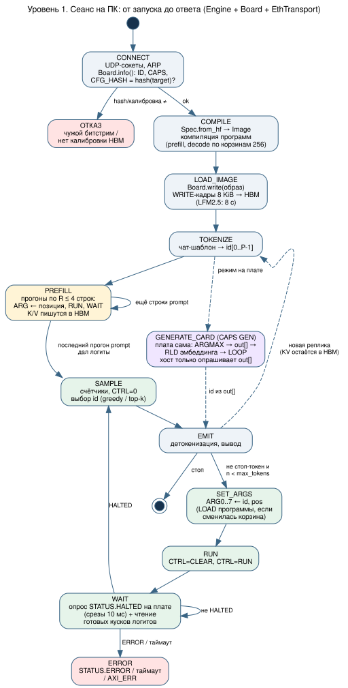
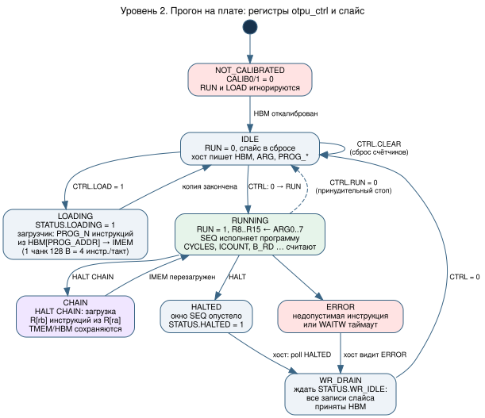
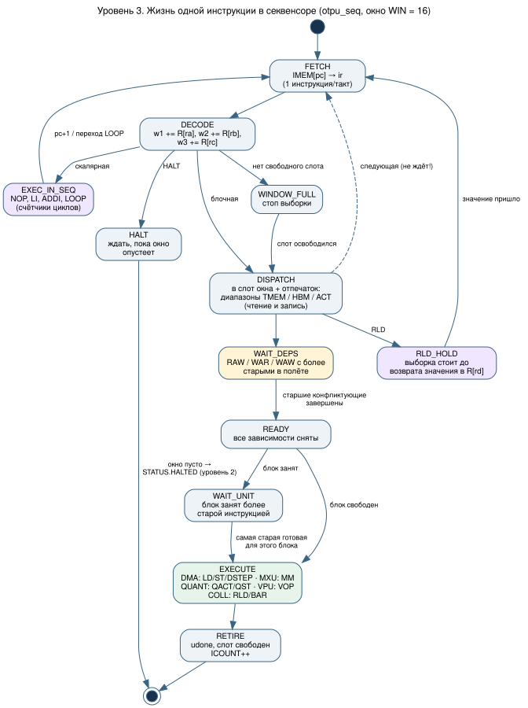
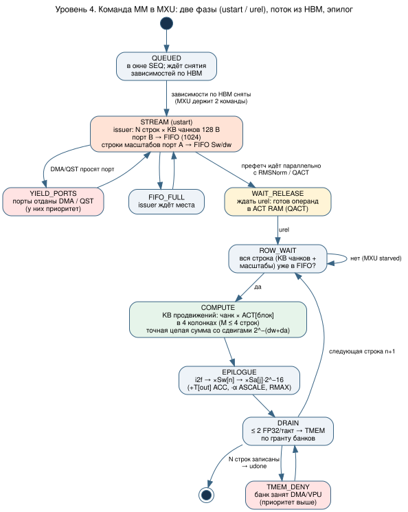
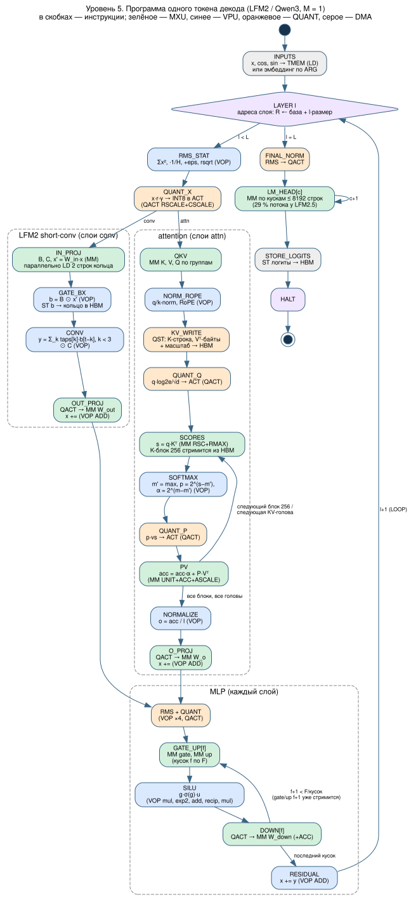

# Алгоритм работы VCU128 openTPU при инференсе LLM

Пошаговый алгоритм от запуска чата на ПК до одного такта MXU, в пяти уровнях вложенности.
На каждый уровень есть диаграмма состояний: `diagrams/algorithm/*.svg`, исходники `.dot`,
пересборка — `diagrams/algorithm/build.sh`. Почему пути данных устроены именно так, разобрано
в [inference.md](inference.md). Источники: upstream `opentpu/host/board.py`, `opentpu/llm/*`,
`rtl/shell/otpu_ctrl.sv`, `rtl/seq/otpu_seq.sv`, `rtl/mxu/otpu_mxu.sv`. Числа — LFM2.5-230M
на конфигурации VCU128 (Lens, `sim/lens/`, и журнал замеров на плате).

| Уровень | Кто исполняет | Длительность для LFM2.5-230M |
|---|---|---|
| 1. Сеанс | Python на ПК | секунды – минуты |
| 2. Прогон | `otpu_ctrl` + слайс | один токен ≈ 19,5 мс устройства (~1,95 Мтакта) |
| 3. Инструкция | `otpu_seq` | 3587 инструкций на токен |
| 4. Команда MM | `otpu_mxu` | строка весов = KB тактов (при K = 1024 это 8 тактов) |
| 5. Программа токена | весь слайс | 14 слоёв + LM head |

---

## Уровень 1. Сеанс на ПК



```text
1. CONNECT
   - открыть два UDP-сокета (память / регистры) к 192.168.41.2:20308; ответ ARP;
   - Board.info(): ID = "OTPU", CAPS, CFG_* ;
   - если CFG_HASH ≠ arch_hash(target) или CALIB0/1 = 0 → ОТКАЗ.
2. COMPILE
   - Spec.from_hf(модель) → Image: раскладка HBM (I/O, слои, LM head, KV, таблицы);
   - квантование весов: INT8 (или FP4) + строки масштабов Sw/dw;
   - компиляция программ ISA: prefill (R строк) и decode — одна на корзину
     позиций по 256 (длина attention), параметры позиции идут через ARG.
3. LOAD_IMAGE
   - Board.write(0, образ): разбить на beat 64 B по двум каналам (чередование + CHASH),
     WRITE-кадры по 8 KiB, окно 12 кадров, повтор по таймауту 20 мс;
   - для LFM2.5-230M — 8 с, примерно 2,2–2,7 ГБ/с.
4. TOKENIZE: чат-шаблон → id[0..P−1].
5. PREFILL: для p = 0, R, 2R, … (R ≤ 4 = MCOLS):
   - ARG ← (p, R); LOAD программы prefill (если её нет в IMEM); RUN; WAIT (см. уровень 2);
   - программа пишет K/V всех R строк в HBM; логиты нужны только у последнего прогона.
6. Цикл генерации:
   a. SAMPLE: id = argmax(логиты) или top-k/top-p;  CTRL = 0;
   b. EMIT: детокенизация; если id ∈ стоп-токены или n = max → выход;
   c. SET_ARGS: ARG0..7 ← (id · длина строки эмбеддинга, pos, …);
      если pos перешёл в новую корзину 256 → LOAD программы этой корзины;
   d. RUN: CTRL = CLEAR, CTRL = RUN;
   e. WAIT: на плате опрашивается (STATUS & HALTED) срезами по 10 мс;
      пока прогон идёт — READ готовых кусков логитов (vocab × 4 B);
      HALTED → прочитать CYCLES/ICOUNT/B_RD…; ERROR/таймаут → исключение;
   f. pos += 1 → a.
7. Новая реплика: снова 4–6. KV прежних позиций остаётся в HBM.
```

Альтернативный режим **GENERATE_CARD** (CAPS GEN): хост один раз пишет блок состояния
(токен, позиция, сколько генерировать, настройки выборки, стоп-id) и запускает
программу. Слайс сам делает ARGMAX/top-k, пишет id в `out[]`, через RLD берёт строку
эмбеддинга и повторяет LOOP, цепочки корзин связывает HALT CHAIN. Хост только читает
`out[]`. Это убирает шаги a–e с ПК; сейчас для LFM2.5 на них уходит до 40 % времени токена.

## Уровень 2. Один прогон на плате



```text
NOT_CALIBRATED → IDLE           когда оба канала HBM откалиброваны (CALIB0, CALIB1)
IDLE:   слайс в сбросе; хост пишет HBM, ARG0..7, PROG_ADDR, PROG_N
IDLE → LOADING                  CTRL.LOAD = 1 (только при RUN = 0)
LOADING: загрузчик читает PROG_N × 32 B из HBM[PROG_ADDR] через порт B,
         одна строка IMEM (4 инструкции = 128 B) за такт; затем → IDLE
IDLE → RUNNING                  CTRL: 0 → RUN; R8..R15 ← ARG0..7; счётчики идут
RUNNING → CHAIN → RUNNING       HALT с флагом CHAIN: перезагрузить IMEM из R[ra], R[rb]
RUNNING → HALTED                HALT и окно секвенсора пусто
RUNNING → ERROR                 недопустимая инструкция, таймаут WAITW
HALTED/ERROR → WR_DRAIN         хост дожидается STATUS.WR_IDLE (все записи приняты HBM)
WR_DRAIN → IDLE                 CTRL = 0
```

Принудительный стоп (RUN 1 → 0) останавливает слайс сразу. Записи, уже отданные в
память, всё равно доходят, поэтому перед следующим доступом хост ждёт WR_IDLE.

## Уровень 3. Жизнь одной инструкции в секвенсоре



```text
каждый такт:
  FETCH:   ir ← IMEM[pc]                         (IMEM читается на такт вперёд)
  DECODE:  w1 += R[ra]; w2 += R[rb]; w3 += R[rc]
  если опкод ∈ {NOP, LI, ADDI, LOOP}:  исполнить в SEQ, pc ← следующий / начало цикла
  если HALT:  перестать выбирать, ждать пустого окна → STATUS.HALTED
  иначе (блочная инструкция):
     если окно (16 слотов) полно → выборка стоит
     DISPATCH: занять слот, записать отпечаток (диапазоны TMEM/HBM/ACT, чтение/запись),
               отметить конфликты RAW/WAR/WAW со всеми старшими в полёте
     выборка СРАЗУ идёт дальше — не ждёт исполнения
     если RLD: выборка стоит до возврата значения в R[rd]

для каждого блока b ∈ {DMA, MXU, QUANT, VPU, COLL}, каждый такт:
  если b свободен: взять САМУЮ СТАРУЮ из его инструкций, у которой все конфликтующие
                   старшие уже завершены (READY) → EXECUTE
  по окончании: udone → RETIRE, слот свободен, ICOUNT += 1
```

В итоге результаты такие же, как при строго последовательном исполнении, а блоки
работают одновременно. Младшая инструкция никогда не обгоняет старшую, с которой
конфликтует.

## Уровень 4. Команда MM в MXU



MM: `out[j, n] = Σk ACT[j, k] · W[n, k]`, j < M ≤ 4, n < N, k < KB·128.

```text
QUEUED: в окне SEQ, ждёт снятия зависимостей ТОЛЬКО по HBM
STREAM (ustart):                     ← начинается до готовности активаций!
   для n = 0..N−1, k = 0..KB−1:
      запрос чанка W[n, k·128 .. +127] (128 B) на порт B → FIFO чанков (1024)
      запрос строки масштабов (Sw[n], dw[n,k]) на порт A → FIFO масштабов
   порты уступаются DMA и QST; при полном FIFO issuer ждёт
WAIT_RELEASE: ждать urel — готов операнд в ACT RAM (его пишет QACT)
для каждой строки n:
   ROW_WAIT: ждать, пока все KB чанков строки и её масштабы в FIFO (иначе «MXU starved»)
   COMPUTE:  KB продвижений; в колонке j: acc[j] += Σ_{i<128} W[n,k,i]·ACT[j,k,i]
             с точным сдвигом 2^−(dw+da) на группу 32 элементов (DSP48E2, цепочки по 16)
   EPILOGUE: y = (i2f(acc[j]) · Sw[n]) · (Sa[j] · 2^−16)
             ACC: y += T[out];  ASCALE: y = T[out]·α + y;  RMAX: max по строке
   DRAIN:    ≤ 2 FP32/такт в TMEM[out + j·ors + n] при гранте банков
             (DMA и VPU имеют приоритет → TMEM_DENY)
после N строк: udone
```

MXU держит две команды: пока одна досчитывается и сливается, issuer уже стримит
веса следующей. При M = 1 работает одна колонка из четырёх, и строка весов из KB чанков
обрабатывается за KB тактов. Скорость упирается в порт B (128 B/такт), а не в арифметику.

## Уровень 5. Программа одного токена декода



```text
INPUTS: LD x, cos, sin → TMEM          (или эмбеддинг по ARG в резидентном режиме)
LOOP по слоям l = 0..L−1 (адреса слоя: R ← база + l·размер блока слоя):
   RMS_STAT:  r = rsqrt(Σx²/H + eps)                          VOP RSSQ, MUL, ADD, RSQRT
   QUANT_X:   ACT ← int8(x·r·γ)                               QACT RSCALE+CSCALE
   если слой conv (LFM2):
      IN_PROJ:  [B, C, x'] = W_in·x                           MM (одновременно LD 2 строк кольца)
      GATE_BX:  b = B ⊙ x';  ST b → кольцо состояния в HBM     VOP MUL, ST
      CONV:     y = (Σ_{k<3} taps[k] ⊙ b[t−k]) ⊙ C            VOP MUL/ADD
      OUT_PROJ: ACT ← int8(y);  x += W_out·y                  QACT, MM, VOP ADD
   если слой attention:
      QKV:       k = W_k·x, v = W_v·x, q = W_q·x (по группам) MM ×(2 + групп)
      NORM_ROPE: q/k-norm, RoPE                               VOP
      KV_WRITE:  K[pos] ← int8(k) + масштаб; Vᵀ[:, pos] ← int8(v) + масштаб   QST
      для каждой KV-головы h и блока токенов b (по 256, до pos):
         QUANT_Q: ACT ← int8(q_h · log2e/√d)                  QACT CSCALE+DUP (раз на голову)
         SCORES:  s = q·K[b]ᵀ  — K-блок стримится из HBM      MM RSC+RMAX
         SOFTMAX: m' = max(m, max s); p = 2^(s−m'); α = 2^(m−m')     VOP MAX, EXP2SUB
         QUANT_P: ACT ← int8(p · vs)                          QACT
         PV:      acc = acc·α + P·Vᵀ[b] — Vᵀ стримится из HBM MM UNIT+ACC+ASCALE
         l = l·α + Σp;  m = m'                                VOP
      NORMALIZE: o = acc / l                                  VOP RECIP, MUL
      O_PROJ:    ACT ← int8(o);  x += W_o·o                   QACT, MM, VOP ADD
   MLP:
      ACT ← int8(rmsnorm(x))                                  VOP ×4, QACT
      для каждого куска f по F:
         g, u = W_gate[f]·x, W_up[f]·x                        MM, MM
         h = g·σ(g)·u                                         VOP MUL, EXP2, ADD, RECIP, MUL
         ACT ← int8(h);  y (+)= W_down[:, f]·h                QACT, MM (+ACC)
         (gate/up куска f+1 уже стримятся, пока VPU считает SiLU куска f)
      x += y                                                  VOP ADD
FINAL_NORM: ACT ← int8(rmsnorm(x))
LM_HEAD:    для кусков c ≤ 8192 строк словаря: logits[c] = W_head[c]·x     MM
STORE:      ST logits → HBM (I/O-область)
HALT
```

### Как это выглядит во времени (LFM2.5-230M, pos 8, RTL)

- Подряд идут 14 слоёв: 8 conv и 6 attention в порядке `layer_types`, вместе
  1,39 Мтакта, в среднем около 99 тыс. на слой. Затем LM head — 8 MM по 8192 строки,
  с такта 1 387 894, то есть 29 % токена (`sim/lens/out/lfm2_pos8_axi.html`,
  вкладка Timeline).
- Порт B занят 92–97 % времени, MXU — 99,9 %. VPU (6,5 %) и QUANT (2,9 %) почти
  всегда прячутся за потоком весов: префетч `ustart` начинает читать веса следующего MM,
  пока идут RMSNorm и QACT.
- Итого 1,86–1,96 Мтакта на токен на RTL; на плате намерено 1,95 Мтакта
  (51,3 ток/с устройства). Остальное до 30 ток/с в чате — обмен с ПК на уровне 1.

## Где смотреть каждый уровень вживую

| Уровень | Инструмент |
|---|---|
| 1 | `tools/otpu_chat_eth.py` (вывод скорости), счётчики `Board.run()` |
| 2 | регистры `otpu_ctrl` через `tools/otpu_eth.py` / JTAG-AXI; `otpu-lens` с платы (буфер трассы) |
| 3 | Lens → Floorplan (слоты окна секвенсора: заняты / ждут зависимостей), Instructions (dispatch / start / end) |
| 4 | Lens → Floorplan (уровень FIFO, колонки MXU, TMEM_DENY); Questa `sim/inference/run_questa.sh --gui` (сигналы `otpu_mxu`) |
| 5 | Lens → Timeline и Source (строка компилятора для каждой инструкции); `sim/lens/explain.py` |
| 3–5 | учебный симулятор `sim/pysim/` (`python3 run.py`, плеер `out/player.html`): окно SEQ, FIFO, пути, значения тензоров |
