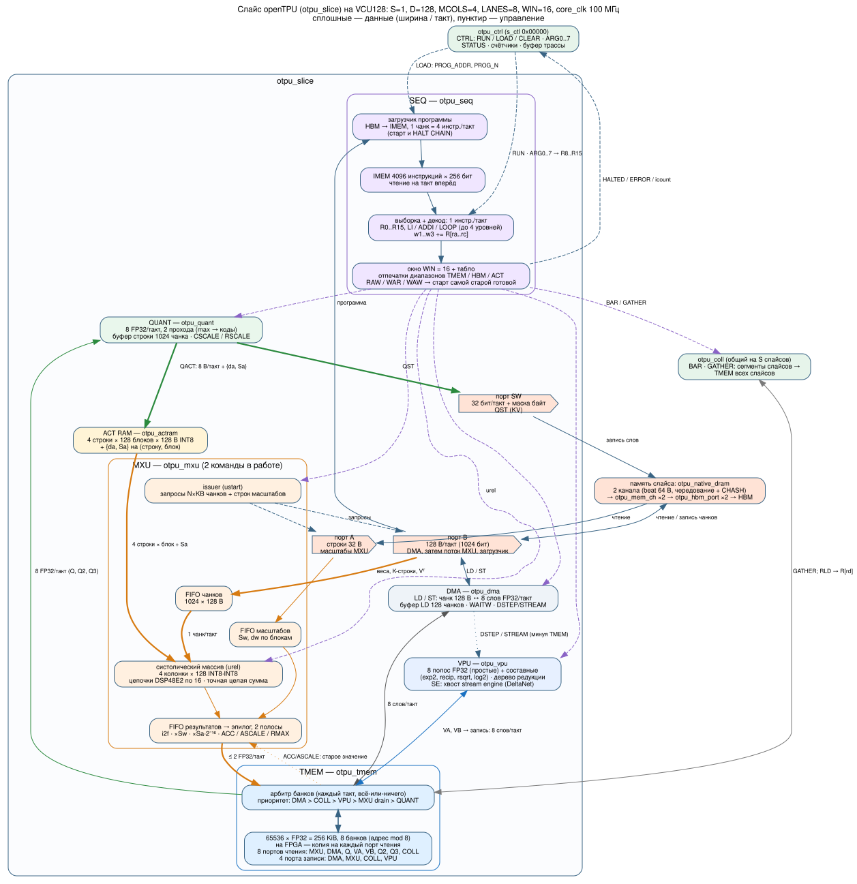

# Слайс openTPU: устройство и работа

**Слайс** (`otpu_slice`, upstream `rtl/top/otpu_slice.sv`) — одна полная копия вычислительного
ядра openTPU со своей памятью программы, своими блоками и своими каналами памяти. По сути, это
отдельный маленький ускоритель, как ядро в многоядерном процессоре. Число слайсов задаёт
параметр `S` в `target/vcu128.toml`; сейчас S = 1.

Схема: [diagrams/slice_structure.svg](diagrams/slice_structure.svg) (исходник `.dot`, PDF рядом).
Та же схема в TikZ, KiCad 10, SVG с ручной раскладкой и изометрии —
[diagrams/variants/](diagrams/variants/index.html) (сравнение, описание в
[diagrams/README.md](diagrams/README.md)).
Пути данных всего тракта ПК → HBM → слайс — [inference.md](inference.md); алгоритм токена —
[inference_algorithm.md](inference_algorithm.md); как компилятор пишет программы для слайсов —
[compiler.md](compiler.md).



## 1. Место в иерархии

```
otpu_vcu128_top                       (проект: тактирование, HBM IP, 40G, регистры платформы)
└─ otpu_bcu_sys                       (upstream, обёртка BCU1525)
   └─ otpu_board                      (otpu_ctrl: CTRL/STATUS/ARG, буфер трассы)
      ├─ otpu_top
      │  ├─ otpu_slice [0 .. S-1]     ← этот документ
      │  └─ otpu_coll                 (BAR, GATHER между слайсами)
      └─ на каждый слайс: otpu_native_dram → otpu_mem_ch ×2 → otpu_hbm_port ×2 → HBM
```

Память слайса вынесена наружу (в `otpu_top`/`otpu_board`), чтобы платы могли менять её
реализацию. Слайсу видны только три порта (A, B, SW) с простым контрактом: запрос, готовность,
ответ по порядку и признаки «записи приняты» / «чтений в полёте нет».

## 2. Состав

| Блок | Модуль | Строк | На VCU128 | Что делает |
|---|---|---:|---|---|
| Секвенсор | `seq/otpu_seq.sv` | 1481 | IMEM 4096 инструкций, R0..R15, окно 16 | выборка, декод, регистры и циклы, раздача команд с табло зависимостей |
| Загрузчик | в `otpu_slice` | — | 1 чанк = 4 инструкции/такт | HBM → IMEM при старте и по HALT CHAIN |
| DMA | `dma/otpu_dma.sv` | 949 | 128 B/такт ↔ 8 слов FP32/такт | LD, ST, WAITW, DSTEP/STREAM |
| MXU | `mxu/otpu_mxu.sv` | 1669 | 4 колонки × 128, FIFO 1024 чанка, эпилог на 2 полосы | MM: INT8 (и 4 бит) × INT8, точная сумма, FP32-эпилог |
| ACT RAM | `mem/otpu_actram.sv` | 196 | 4 строки × 128 блоков × 128 B | стационарные операнды MM по диапазонам блоков (`ab`) |
| Квантователь | `vpu/otpu_quant.sv` | 874 | 8 FP32/такт, буфер строки 1024 чанка | QACT (→ ACT RAM), QST (→ HBM: KV-кэш) |
| VPU | `vpu/otpu_vpu.sv` (+ `otpu_fp`, `otpu_vtree`, `otpu_se_*`) | 1568 | 8 полос FP32 | VOP: поэлементные, составные (exp2, recip, rsqrt, log2), редукции; хвост stream engine |
| TMEM | `mem/otpu_tmem.sv` | 1047 | 65536 × FP32 = 256 KiB, 8 банков | общая рабочая память активаций, арбитр банков |
| Порты памяти | в `otpu_slice` | — | B 1024 бит, A 256 бит, SW 32 бит | регистры запросов к памяти слайса |

Ресурсы одного слайса с оболочкой в сборке VCU128: DSP 722, BRAM ≈ 563 (из них TMEM — копия
на каждый порт чтения, около 380), LUT ≈ 159 тыс. на всю прошивку (12 %).

## 3. Общие ресурсы и арбитраж

Блоки работают одновременно. Каждый такт три общих ресурса делятся между ними:

**TMEM.** 8 банков (банк = адрес mod 8). На FPGA у каждого порта чтения своя копия памяти,
поэтому чтения не конфликтуют; запись — одна на банк за такт (WPB = 1). Порты:

| Чтение (8) | Запись (4) |
|---|---|
| MXU (ACC/ASCALE), DMA (ST), Q, Q2, Q3 (квантователь), VA, VB (VPU), COLL (GATHER, RLD) | DMA (LD), MXU (выгрузка), COLL (GATHER), VPU |

Грант выдаётся блоку **целиком или никак** в порядке приоритета **DMA > COLL > VPU > выгрузка
MXU > QUANT**. Не получивший грант блок держит своё состояние. Компилятор даёт выходам MXU
нечётный шаг строк, чтобы M результатов одной строки попадали в разные банки.

**Порт B** (128 B/такт) — первым обслуживается DMA, затем поток весов MXU; через него же
загрузчик читает программу. Ответы на чтение возвращаются по тегу владельцу.

**Порт A** — строки масштабов MXU (32 B); **порт SW** — запись одного 32-битного слова с маской
байт за такт для QST (дописывание K-строки и столбца Vᵀ с чтением-модификацией beat).

## 4. Как работает: алгоритм слайса

### 4.1 Жизненный цикл прогона

```text
1. СБРОС (rst = 1, CTRL.RUN = 0): блоки и секвенсор стоят; хост пишет HBM и ARG.
2. ЗАГРУЗКА (CTRL.LOAD): загрузчик ждёт, пока в памяти нет чтений слайса (rd_idle), и копирует
   PROG_N инструкций из HBM[PROG_ADDR] в IMEM по чанку (4 инструкции) за такт.
3. ПУСК (CTRL: 0 → RUN): R8..R15 ← ARG0..7; секвенсор начинает с pc = 0.
4. ИСПОЛНЕНИЕ: каждый такт — шаги 4.2.
5. HALT: секвенсор перестаёт выбирать и ждёт пустого окна → STATUS.HALTED.
   HALT CHAIN: дождаться wr_idle, держать блоки в сбросе, загрузить следующую программу
   (адрес R[ra], длина R[rb]), отпустить — TMEM, HBM и R8..R15 сохраняются; HALTED не
   поднимается, ICOUNT считает все программы прогона.
6. Хост ждёт WR_IDLE (все записи приняты памятью) и снимает RUN.
```

### 4.2 Один такт исполнения

```text
ВЫБОРКА И РАЗДАЧА (otpu_seq)
  ir ← IMEM[pc] (IMEM читается на такт вперёд, по адресу, куда пойдёт pc)
  если NOP / LI / ADDI / LOOP: исполнить в секвенсоре, pc ← следующий / начало тела
  если RLD: отправить в COLL, держать выборку до возврата значения в R[rd]
  если HALT: перестать выбирать
  иначе, если в окне есть место:
     поля адресов += R[ra], R[rb], R[rc]
     записать в окно вместе с отпечатком: какие диапазоны TMEM / HBM / ACT RAM читает и пишет
     отметить конфликты (RAW / WAR / WAW) со всеми старшими инструкциями в окне

СТАРТ БЛОКОВ
  DMA, QUANT, COLL: свободный блок берёт самую старую свою инструкцию, если все её
                    конфликты завершены (стартуют по порядку)
  VPU:              самую старую готовую (может обогнать младшую независимую)
  MXU, две фазы:    ACCEPT (ustart) — как только сняты конфликты по HBM: issuer начинает
                    стримить веса в FIFO (MXU держит 2 команды);
                    RELEASE (urel) — когда сняты все конфликты (готов операнд в ACT RAM)

ПАМЯТЬ
  порт B: DMA, иначе следующий чанк issuer'а MXU; порт A: строка масштабов; порт SW: слово QST

MXU
  строка весов n начинает считаться, только когда все её KB чанков и масштабы уже в FIFO;
  KB продвижений по такту: колонка j суммирует 128 произведений ACT[j][блок] × W[n][блок]
  точно в целых (сдвиги 2^−(dw+da) по группам из 32);
  итог строки → FIFO результатов → эпилог (i2f · Sw[n] · Sa[j]·2⁻¹⁶, ACC/ASCALE/RMAX) →
  ≤ 2 FP32 за такт в TMEM при гранте банков

TMEM
  арбитр выдаёт гранты по приоритету DMA > COLL > VPU > MXU drain > QUANT

ЗАВЕРШЕНИЕ
  блок, закончивший инструкцию, сообщает udone: слот окна освобождается, ICOUNT += 1,
  зависящие от неё инструкции становятся готовыми
```

Итог: результаты такие же, как при строго последовательном исполнении — младшая инструкция
никогда не обгоняет старшую, с которой конфликтует, — но блоки перекрываются, и поток весов
идёт почти без пауз (порт B занят 92–97 % на LFM2.5, `sim/lens`).

### 4.3 Что делает слайс за один токен

Для LFM2.5-230M (RTL, pos 8): 3587 инструкций, 1,86–1,96 Мтакта; MXU занят 99,9 %, VPU 6,5 %,
QUANT 2,9 %, DMA 1,4 %. Почти всё время — поток весов через порт B в MXU; остальные блоки
работают в его тени. Подробный разбор шагов слоя — [inference.md](inference.md) §6.

## 5. Несколько слайсов

```
             ┌────────── otpu_coll: BAR, GATHER ──────────┐
             │                                            │
 slice 0 ── TMEM ── HBM ch0, ch1     slice 1 ── TMEM ── HBM ch2, ch3   …   slice S-1
   своя программа (SPMD)               своя программа
```

- **Программы.** Компилятор трассирует ядро для каждого слайса отдельно (`ol.program_id()`),
  у каждого своя программа в своём IMEM; хост грузит и запускает все.
- **Веса делятся по строкам** (`Weight(w, shard=0)`): каждый слайс хранит в своих каналах HBM
  и стримит только свою часть. Поток весов за такт растёт в S раз — это и ускоряет декод.
- **Обмен — GATHER.** Когда все слайсы ждут один и тот же коллективный вызов, `otpu_coll`
  стримит сегмент каждого слайса (до 8 слов за такт) и раздаёт его в TMEM всех слайсов, затем
  отпускает их вместе; грант — И грантов TMEM всех слайсов. Пример — MLP: после SiLU каждого
  куска слайсы обмениваются им, каждый умножает его на свои строки W_down; редукции нет.
- **BAR** — барьер. При S = 1 GATHER в сборке отсутствует (COLL_GATHER = 0), компилятор его не
  выдаёт.
- **KV-головы** раздаются по слайсам: модель с n_kv KV-головами ложится только на S, делящее
  n_kv (Qwen3.5-2B: n_kv = 2 → S ≤ 2; Qwen3.5-4B: n_kv = 4 → S ≤ 4).

Замеры на RTL (Lens, LFM2.5-230M int8, pos 8): S = 1 — 1 858 909 тактов, S = 2 — 952 196
(×1,95), S = 4 — 504 475 (×3,68). Меньше идеала из-за GATHER и частей, которые не делятся.

На VCU128 4 слайса требуют: TMEM в UltraRAM (по BRAM 4 × 563 > 2016), порты HBM SAXI_04..15,
40G-мост на 2S каналов, разнесения слайсов по SLR (HBM только у нижнего) — `TODO.md` шаг 3.

## 6. Где посмотреть слайс в работе

| Инструмент | Что видно |
|---|---|
| Lens (`sim/lens/`, вкладка Floorplan) | настоящий RTL: блоки, FIFO, банки TMEM, слоты окна, пути — по тактам |
| Учебный симулятор (`sim/pysim/`, `player.html`) | та же картина в упрощённой модели, с числами тензоров |
| Questa (`sim/inference/run_questa.sh --gui`) | сигналы одного `otpu_mxu`: запросы, FIFO, выгрузка |
| Плата (`otpu_ctrl`) | CYCLES, ICOUNT, B_RD/B_WR/A_RD/SW_WR/B_STALL, буфер трассы (`otpu-lens`) |
