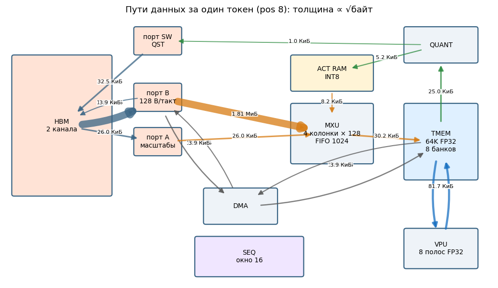
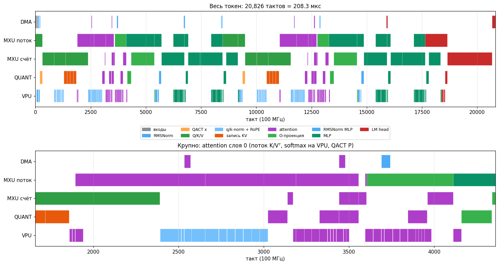
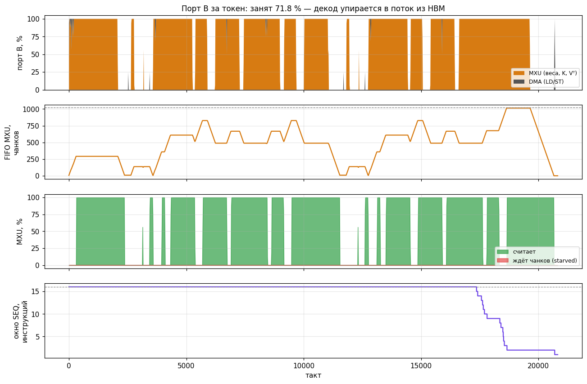
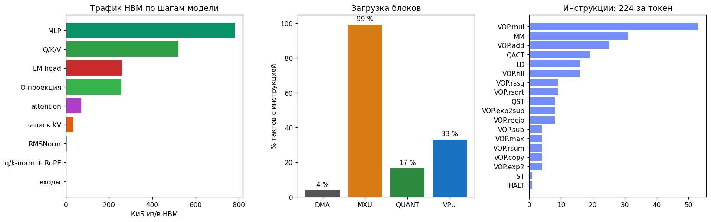
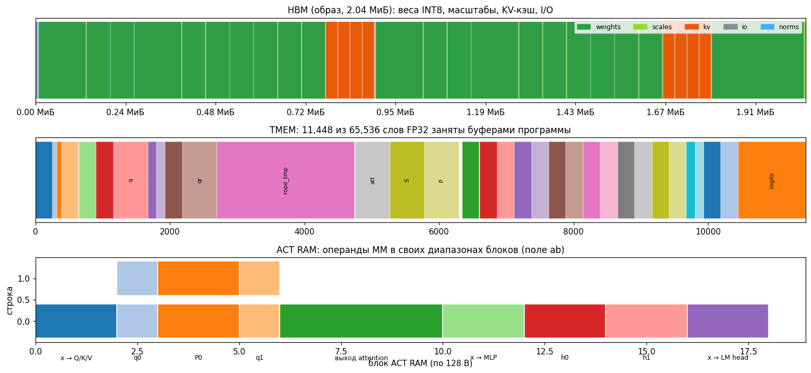
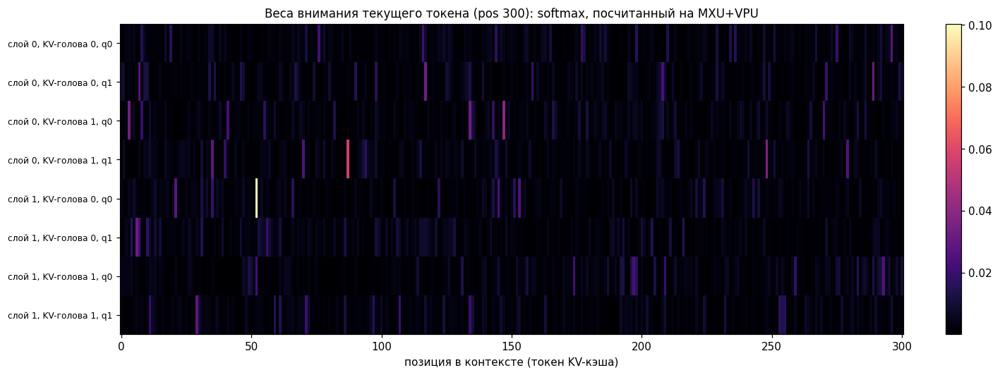
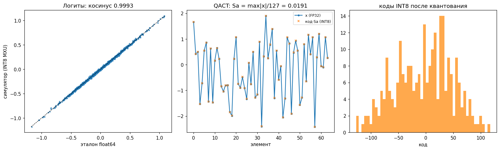
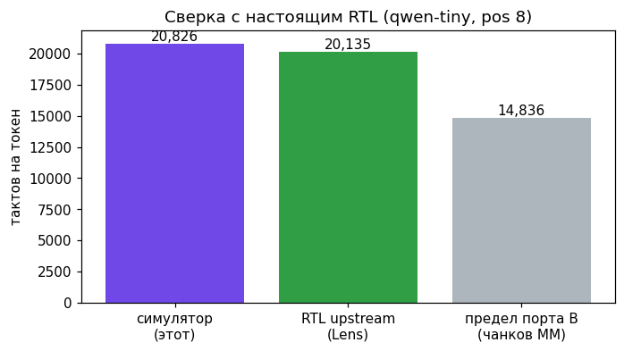

# Учебный симулятор слайса openTPU на Python

Потактовая модель одного слайса с параметрами VCU128 (D=128, MCOLS=4, LANES=8, окно 16,
FIFO 1024). Она исполняет программу одного токена маленькой Qwen3 и показывает, **как
считается** токен (настоящие числа INT8/FP32), **куда едут данные** (HBM, порты, DMA, MXU,
ACT RAM, QUANT, VPU, TMEM) и **почему это занимает столько тактов** (табло зависимостей,
перекрытие блоков, поток весов через порт B).

Код — около 1400 строк Python (плюс HTML-плеер) и читается сверху вниз: у каждого блока свой алгоритм в отдельной
функции. Нужны только numpy и matplotlib, upstream не нужен. Полную точность RTL
даёт Lens (`../lens/`); здесь — понятность при близких цифрах:

| Сверка (pos 8) | Симулятор | RTL upstream (Lens) |
|---|---:|---:|
| тактов на токен | 20 826 | 20 135 (−3,4 %) |
| загрузка MXU / VPU / QUANT / DMA | 99 / 33 / 17 / 4 % | 99,1 / 36,7 / 17,2 / 3,4 % |
| порт B занят | 71,8 % | 74,2 % |
| логиты против float64 | косинус 0,9993, топ-5 = 5/5 | — |

## Запуск

```bash
cd vcu128_otpu/sim/pysim
python3 run.py                     # pos 8: рассказ в консоли, out/*.png, out/player.html
python3 run.py --pos 300           # 301 токен контекста: два блока attention, онлайн-softmax
python3 run.py --narrate 300       # рассказ по каждой инструкции с её числами
python3 -m pytest -q test_pysim.py # 7 проверок, ~3 с
```

`out/player.html` — автономная страница, открывается браузером без сервера:

- **Схема и анимация.** Блоки слайса загораются, по активным путям бежит пунктир цвета
  шага модели. В MXU показан уровень FIFO, в SEQ — 16 слотов окна: жёлтый ждёт
  зависимостей, зелёный исполняется. Справа — исполняемые сейчас инструкции:
  что делают, откуда и куда, первые значения результата.
- **Таймлайн и счётчики.** Диаграмма Ганта по блокам (MM разбит на «поток» и «счёт»);
  щелчок переходит к такту, колёсико масштабирует. Ниже — порт B, FIFO и окно.
- **Внимание и числа.** Тепловая карта весов внимания, логиты против эталона и разбор
  QACT, MM, QST на живых числах.
- **Память.** Карты HBM и TMEM, трафик по каждому пути.
- **Инструкции.** Таблица с фильтром; щелчок переходит к инструкции на схеме.

Пробел — пуск/пауза, ← → — предыдущая/следующая инструкция.

## Что показывают графики (`figures/`, пересобираются в `out/`)

| Файл | Что видно |
|---|---|
|  | **Пути данных за токен.** Толщина стрелки ∝ √байт. Почти весь трафик — HBM → порт B → MXU (1,8 МиБ весов); остальные пути — килобайты |
|  | **Диаграмма Ганта.** «MXU поток» начинается раньше «MXU счёт»: веса уже грузятся, пока QUANT квантует операнд. Внизу крупно attention: скоры, softmax на VPU, QACT P, P·Vᵀ |
|  | **Счётчики.** Порт B занят 72 %. Провалы — моменты, когда MXU ждёт VPU/QUANT (RoPE, softmax). Окно секвенсора почти всегда полно |
|  | **Куда идут байты и время.** MLP и Q/K/V дают большую часть трафика; MXU занят 99 % |
|  | **Карты памяти.** HBM: веса, масштабы, KV-кэш. TMEM: буферы FP32. ACT RAM: операнды MM по диапазонам блоков (`ab`) |
|  | **Веса внимания** при 301 токене: 2 блока по 256, онлайн-softmax склеивает их через α |
|  | **Числа.** Логиты против float64; QACT: x и код·Sa; распределение кодов INT8 |
|  | **Сверка с RTL.** Такты симулятора, RTL upstream и предел порта B |

## Как устроен код

| Модуль | Что моделирует |
|---|---|
| `otpusim/config.py` | параметры `target/vcu128.toml` и временные константы, подобранные по Lens |
| `otpusim/memory.py` | HBM (байты, 2 канала по beat 64 B), TMEM (65536 FP32), ACT RAM (4 строки × 128 блоков + Sa[строка][блок]) |
| `otpusim/isa.py` | LD, ST, MM, QACT, QST, VOP, HALT — поля как в upstream `docs/isa.md`; у каждой инструкции «отпечаток» для табло |
| `otpusim/units.py` | **алгоритмы блоков на данных**: DMA копирует; MXU — точная целая сумма INT8 + эпилог `acc·Sw·Sa` (ACC, ASCALE, RMAX); QUANT — `Sa = max/127`, `round(x/Sa)`; QST — запись K-строки и столбца Vᵀ; VPU — поэлементные операции и редукции |
| `otpusim/machine.py` | **время**: выборка в окно 16, табло RAW/WAR/WAW, старт самой старой готовой; MXU в две фазы (поток в FIFO после зависимостей по HBM, счёт — после всех); порт B — DMA с приоритетом; строка MXU начинается, когда все её чанки в FIFO; выгрузка 2 FP32/такт |
| `otpusim/model.py` | Qwen3-tiny (веса как у `lens._tiny_qwen`), раскладка HBM, **компилятор одного токена** по образцу upstream `qwen3_step`: RMSNorm внутри QACT, Q/K/V, q/k-norm, RoPE, QST K/Vᵀ, flash-attention блоками по 256, O, MLP кусками с SiLU, LM head, ST логитов |
| `otpusim/reference.py` | тот же Qwen3 в float64 без квантования |
| `otpusim/report.py` | графики, данные плеера, рассказ |

Каждая инструкция несёт русское описание. Пример из `run.py --narrate`:

```
[  9]      9…855    MXU   MM   K-проекция: 256×256 INT8 = 64 KiB стримятся из HBM в MXU (512 чанков
                            по 128 B), 1 строк(и) из ACT RAM (блок 0) → FP32 в TMEM (счёт с 320)
[ 39]   1296…1436  QUANT QST  K головы 0, позиция 8: INT8 + FP32-масштаб → HBM (строка 128 B)
                            → HBM INT8: -1 47 -11 -33 26 55 -37 -9 · s=0.03259
MM K (скоры q·Kᵀ): строка ACT = [-35 -32 -9 …]·Sa=0.002824, строка весов = [32 -37 33 …]·Sw=0.01949;
                   целая сумма acc = -10317; y = acc·Sw·Sa = -0.56777
```

## Упрощения (честно)

- INT8 с одним масштабом на строку. В upstream ещё 5-битные смещения 2^−d на группу
  из 32 элементов (MX) и форматы FP4. Логика путей и инструкций от этого не меняется.
- Память — фиксированная задержка 20 тактов, без модели HBM/AXI и без конфликтов
  банков TMEM. VPU — один конвейер с подобранными задержками (у RTL есть составные и
  простые полосы).
- Программу пишет свой компилятор по образцу upstream: 224 инструкции против 255 у
  upstream (нет LOOP по слоям, иначе устроены некоторые слияния). Для точной картины
  RTL используйте Lens.
- `test_pysim.py` проверяет: логиты против float64 на pos 0/8/300 (косинус > 0,998);
  потактовый прогон с перекрытием даёт побитно те же логиты, что последовательный
  (свойство табло); такты в пределах 10 % от RTL; загрузку блоков; конфликты
  табло; чередование каналов.
